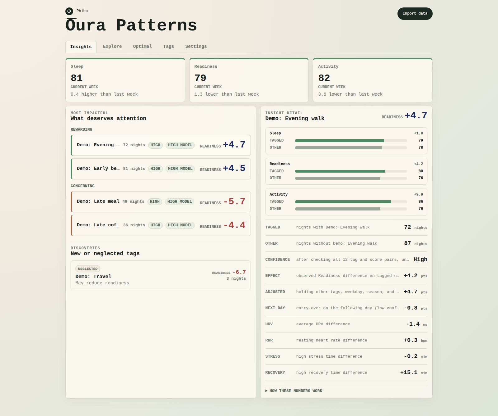

# Try Phibo with synthetic Oura data

Explore Phibo without an Oura account, API key, or personal health data.
[Download the synthetic Oura ZIP](phibo-synthetic-oura.zip?raw=true)
(save the file; no need to unzip it).

Every value, date, and tag was generated from scratch. The sample contains
181 days (January 1–June 30, 2025), six CSV files, and six tags labelled
**Demo:**. It includes sleep, readiness, activity, sleep stages, heart rate,
HRV, steps, and stress/recovery minutes. Other optional Oura metrics are absent.
The built-in patterns illustrate the interface; they are not evidence about
health, causation, or what any habit will do for you. Meditation has no built-in
score effect, and Travel deliberately has too few days for a reliable estimate.

## Import in a few clicks

1. Install/load Phibo using the [development instructions](../../README.md#development).
   Use a separate browser profile for this demo: imports merge into the current
   local database, so importing alongside your own records would mix the samples.
2. Open the extension popup and click **Open Dashboard**.
3. Click **Import data**, then **Choose files**, and select
   `phibo-synthetic-oura.zip`. You can also drop the ZIP into the import panel.
   No Oura key or sync is needed.
4. Confirm the message reports **181 days** from **6 Oura files**, then click
   **Close**. Let the analysis finish; **Insights** will show rewarding and
   concerning Demo tags. Click a tag to compare its scores and confidence.
5. Try **Explore** with **Demo: Evening walk** or **Demo: Late meal**, inspect
   the timeline and matching nights, then open **Optimal** to try tag combinations.
   **Tags** shows the generated day-by-day log. Some days intentionally have no
   tags and are excluded by default; toggle this in **Settings** to compare.
   Keep the default morning tag timing for this sample: tag dates refer to the
   morning the corresponding sleep ended.

When finished, remove the demo browser profile. Alternatively, in that dedicated
profile use **Settings → Delete local data → Confirm delete** before importing
your own export. That action deletes all imported data in that profile.

## What it looks like

Actual Phibo Insights view after importing this ZIP in a clean browser profile:



## Reproduce the sample

From the repository root, after `npm ci`:

```sh
node scripts/generate-demo-data.mjs
```

The script uses a fixed seed, UTC dates, and fixed ZIP metadata. It does not read
any Oura export, credentials, or local database. The CSV headers match Phibo's
supported Oura import fields; this is a small compatible fixture, not a complete
replica of every file in an Oura personal export. Regenerate the screenshot from
a clean profile after importing the regenerated ZIP if the data or UI changes.
